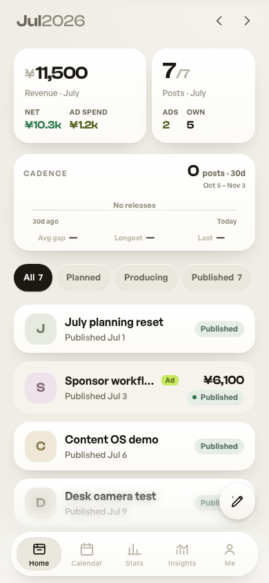
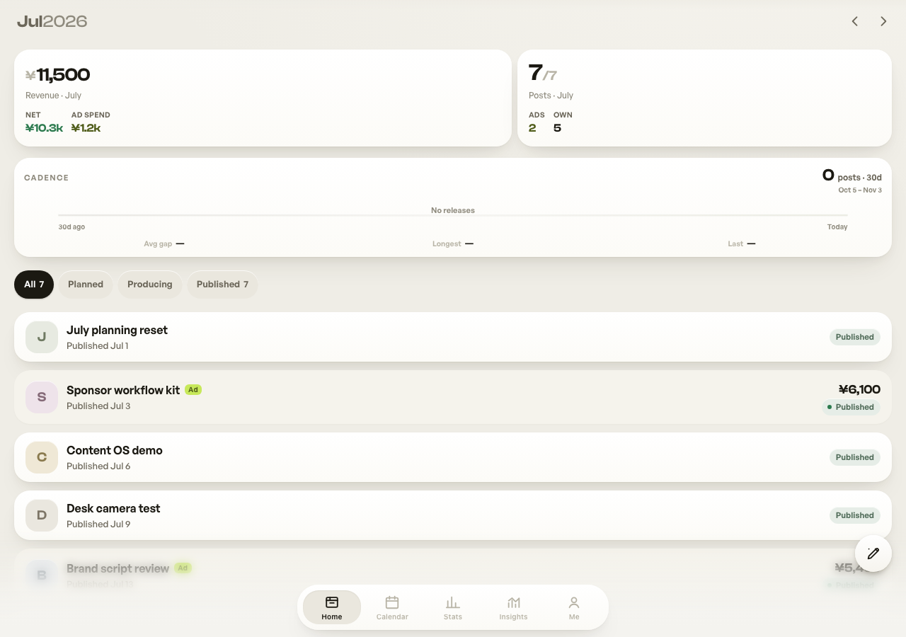

# Content Manager Skill · 内容管家

一句话生成自己的自媒体管理工具，保留原版 Ledger 暖纸色界面与功能。包内附完整源码，可在本地启动、继续定制，也可选配自己的云同步。

## 界面预览

手机端：



桌面端：



## 安装 Skill

将这个完整目录放到支持 Agent Skills 的工具的技能目录。Codex 的个人技能目录为 `~/.codex/skills/content-manager/`，核心文件 `SKILL.md` 应在该目录根部；不要只复制 Markdown 而遗漏 `assets/template/`。

直接从 GitHub 安装到 Codex（目标目录需不存在）：

```bash
mkdir -p ~/.codex/skills
git clone https://github.com/alanxuyiyao-hash/content-manager-skill.git ~/.codex/skills/content-manager
```

在新的对话中调用。更新时可在该目录执行 `git pull --ff-only`。

示例请求：

> 使用 $content-manager 帮我生成一个自媒体管理工具，保留现有样式和功能。

也可以直接运行，不依赖任何 AI 服务或 API key：

```bash
python3 scripts/create_app.py --output /path/to/new-content-manager
cd /path/to/new-content-manager
npm ci
npm run dev -- --host 127.0.0.1
```

目标目录必须不存在，其父目录必须存在。需要 Python 3.9+、Node.js 22.12+ 与安装依赖所需的网络。

## 包含什么

- Home 内容项目与商单、Calendar 发布排期、Stats 收支分析、Insights 内容表现、Me 设置与备份。
- 原有项目编辑、快记、投放与固定开销记录、回款状态、个人资料、隐私展示与 JSON 导入导出。
- 本地 IndexedDB、PWA、可选 Supabase 云同步与 Capacitor Android 源码。
- 生成脚本、云端建表/RLS 迁移与验证 SQL、字体和部署说明。

默认本地运行，无需后端。演示地址加 `?demo`；虚构示例集中在 2026 年 3–7 月。Demo 不是隔离数据库，试用导入/导出时使用独立浏览器配置文件。

当前版本没有旧 Inbox、Spark、社交平台数据自动抓取或自动发布。保留当前产品，不恢复历史功能。

## 字体与许可证

仍使用 Clash Display 与 General Sans。默认字体来自 Fontshare 官方 CDN，开源包不分发受限字体二进制；需要完全本地离线字体时，用户从官方独立取得副本后使用应用内的导入脚本。详见 [字体说明](assets/template/docs/fonts.md)。

模板和应用代码采用 [MIT](LICENSE)，第三方软件和字体保留各自许可，见 [第三方说明](THIRD_PARTY_NOTICES.md)。`private: true` 仅用于避免误发 npm 包，不限制源码开源。

## 目录

```text
content-manager/
├── SKILL.md
├── agents/openai.yaml
├── scripts/create_app.py
├── references/template.md
└── assets/template/         完整应用、测试、文档和云端 SQL
```

生成后的应用说明见 [应用 README](assets/template/README.md)。生成器不联网、不安装依赖、不发布网站，也不会访问任何作者账号或现有用户数据。原项目 Git 历史、私有路径和环境文件不在包内。

## 验证与已知边界

构建、测试与开源整理记录见 [验证报告](references/verification.md)。运行时依赖审计为零告警；开发工具链仍有上游低/中危提示，详见 [SECURITY.md](SECURITY.md)。云端实机同步与 Android 真机验证需在自己的环境完成。
